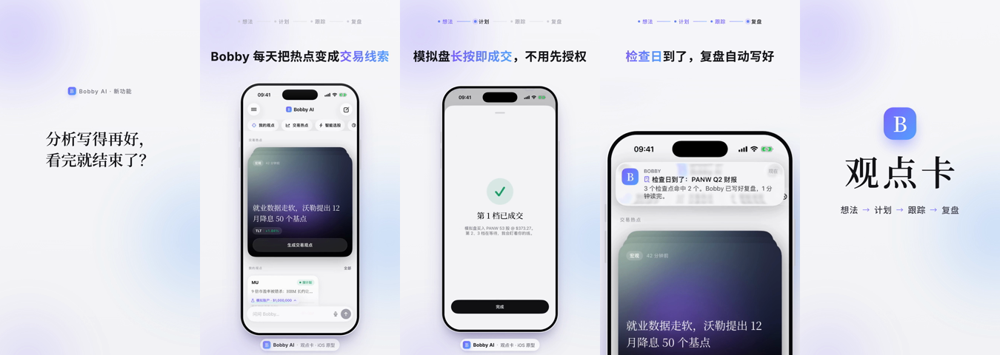

# Bobby · Thesis Card (iOS concept prototype)

An unofficial SwiftUI concept for **Thesis Cards** in Bobby, the AI trading assistant inside RockFlow.
The idea: an AI analysis shouldn't end when you finish reading it. It should turn into a trackable
position that keeps following up on its own.

**Idea → Plan → Track → Review**

1. **Idea**: one tap on a trending story produces a conclusion-first analysis, distilled into a card
   with your conviction vs. the market-implied probability.
2. **Plan**: the card sizes a 3-tranche entry against your own position cap; paper trades fill with a long press.
3. **Track**: Bobby watches the invalidation lines you set and pings you when one is being tested.
4. **Review**: on the check date the review writes itself. Every call becomes a verifiable track record
   (hit rate and calibration over time).


**Product film** (47 s, 1080×1920, with sound): see the [latest release](../../releases/latest).



> Not affiliated with or endorsed by RockFlow. All market data, tickers, and numbers in the app are mock data.

## Repo layout

| Path | What |
| --- | --- |
| `Bobby/` | SwiftUI app (iOS 26, Liquid Glass). All state is local mock data in `Models.swift`. |
| `project.yml` | [XcodeGen](https://github.com/yonaskolb/XcodeGen) spec; `BobbyProto.xcodeproj` is generated from it. |
| `shoot.sh` / `record.sh` | Launch the app in the simulator into a demo state, then screenshot it or record an auto-playing tour. |
| `subset-fonts.sh` | Subsets Noto Serif SC to just the characters the UI uses (~240 KB per weight). |
| `video/` | The product film as a [hypit](https://github.com/hypit-ai/hypit) project. |

## Run the app

```sh
xcodegen            # optional, only after editing project.yml
open BobbyProto.xcodeproj
```

Requires Xcode 26 and the iOS 26 simulator. Demo launch arguments jump straight into a state:
`-demo home|chat|profile|order|watch|banner|review|theses`, plus `-tour` to auto-play that flow
(this is how the film's clips are recorded).

```sh
SIM="iPhone 17 Pro" ./shoot.sh chat 9
SIM="iPhone 17 Pro" ./record.sh order 13.7
```

## Build the film

Everything in the picture is code-rendered by `video/packages/thesis-film` (one phone, eight simulator
recordings, camera punch-ins, captions, a step rail, hook and outro), with the storyboard at the top of `render.ts`.
The soundtrack is an original music bed plus UI effects, synthesized from scratch by
`video/audio/make_soundtrack.py` and locked to the same 30 fps frame grid (112.5 BPM = 16 frames per beat),
so no third-party audio is involved.

```sh
cd video
pnpm install
pnpm soundtrack     # writes assets/audio/{music,sfx}.wav (not committed; needs uv)
pnpm check
pnpm build          # renders final.video; export with `hypit get <build> --output final.video --to out.mp4`
```

## License

Code: MIT. Bundled Noto Serif SC fonts: SIL Open Font License 1.1. See [LICENSE](LICENSE).
